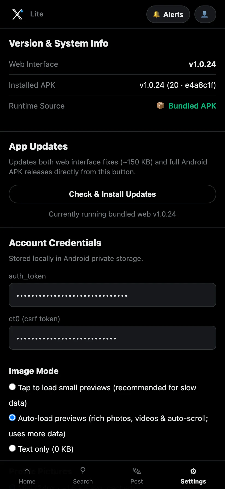
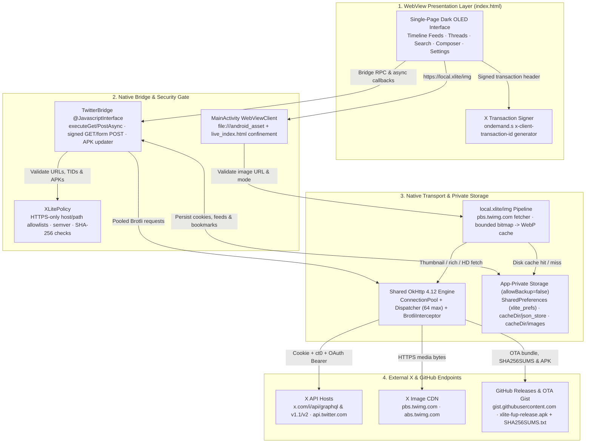

<p align="center">
  
</p>

<h1 align="center">X Lite</h1>

<p align="center">
  <b>An Android X client engineered for constrained, slow, and unreliable networks — featuring Brotli GraphQL transport, lazy WebP media caching, and SHA-256 verified OTA updates.</b>
</p>

<p align="center">
  <a href="https://github.com/sovopr/xlite-android/actions/workflows/ci.yml"></a>
  <a href="https://github.com/sovopr/xlite-android/actions/workflows/codeql.yml"></a>
  <a href="https://github.com/sovopr/xlite-android/releases/latest"></a>
  <a href="https://github.com/sovopr/xlite-android/releases"></a>
  <a href="LICENSE"></a>
</p>

---

## Downloads (v1.0.24)

X Lite ships as a self-contained signed Android APK with zero external runtime trackers or analytics SDKs.

| Platform | Package | Size | Description |
| :--- | :--- | :--- | :--- |
| **Android 7.0+ (API 24+)** | [**`xlite-fup-release.apk`**](https://github.com/sovopr/xlite-android/releases/latest/download/xlite-fup-release.apk) | ~5 MB | Signed release APK bundling the OLED web SPA, native `OkHttp` + Brotli bridge, and in-app updater. |

Every GitHub Release publishes `SHA256SUMS.txt` alongside `xlite-fup-release.apk`. In-app native APK updates automatically verify the downloaded file's SHA-256 digest and non-downgrade `versionCode` via `XLitePolicy` and `TwitterBridge.installApkUpdateVerifiedAsync()` before invoking Android's package installer, while lightweight UI updates patch the live web bundle directly in app-private storage with one-tap revert (**Revert to Bundled Version**).

### Quick Setup
1. Install [`xlite-fup-release.apk`](https://github.com/sovopr/xlite-android/releases/latest/download/xlite-fup-release.apk) on your Android device (Android 7.0 or newer).
2. Open **Settings** and enter your authenticated `x.com` browser cookies (`auth_token` and `ct0`).
3. Credentials are stored strictly on-device in `MODE_PRIVATE` `SharedPreferences` (`android:allowBackup="false"`). Never share your cookie values with anyone.

---

## Features & Interface Workflow

### 1. Low-Bandwidth Feed Engine & Bandwidth Controls
The timeline prioritizes instant readability over multi-megabyte web bundles while letting you scale up to rich media when bandwidth allows:

- **Three Timeline Modes (`Following`, `For You`, `Offline`)**: Switch between chronological `HomeLatestTimeline`, algorithmic `HomeTimeline`, and an offline bookmarked/cached feed backed by local JSON storage (`cacheDir/json_store` and `SharedPreferences`).
- **Configurable Image & Avatar Modes**: Choose between **Tap to load small previews**, **Auto-load previews** (rich photos, inline video with auto-pause off-screen, and lightbox zoom), or **Text only (0 KB)** alongside **Profile Pictures** (`Mini` 24px `_mini`, `Normal`, or `Off`).
- **On-Demand & WebP Transcoding Pipeline**: Requests to `https://local.xlite/img` rewrite `pbs.twimg.com` media URLs cleanly (`thumb` / `rich` / `hd`), decode bounded bitmaps with hardware scaling, re-encode to compact WebP, and persist atomic files in `cacheDir/images/`.
- **Promoted Post Filtering & Seen-Post Sync**: Optional feed toggle suppresses promoted ads, and **Sync Seen Posts to X** sends lingered post IDs (`seenTweetIds`) so already-read posts do not keep reappearing on desktop web.

<p align="center">
  
</p>

### 2. Conversation Threads, Signed Search, Profiles & Composer
Full day-to-day X workflows remain lightweight and responsive without booting X's multi-megabyte React client:

- **Threaded Conversations (`TweetDetail`)**: Tap any post to inspect its full focal view, poll breakdown, and ordered replies, or post an inline reply directly from the thread view.
- **Dual-Bridge Search**: Queries X's GraphQL `SearchTimeline` signed with dynamically fetched `x-client-transaction-id` headers (backed by X's `ondemand.s` script in the WebView), with pagination support and typeahead fallback.
- **Profiles, Notifications & Interactions**: Browse user timelines (`UserByScreenName`), follow/unfollow accounts (`friendships/create` and `destroy`), read alerts (`v2/notifications/all.json`), like, retweet, quote-post, bookmark offline, and publish new posts.

<p align="center">
  
</p>

### 3. Settings, Two-Stage OTA Updater & Privacy Hygiene
Everything is configurable in **Settings**, including transparent version stamps and non-disruptive updates:

- **Live Build Stamp (`Version & System Info`)**: Displays both the active Web Interface version (`v1.0.24`), installed native APK (`versionName`, `versionCode`, and 7-char `BuildConfig.GIT_SHA`), and whether the client is running the **Bundled APK** asset or a **Live OTA Updated** bundle.
- **Unified In-App Updater (`Check & Install Updates`)**: Downloads lightweight web interface updates atomically to `filesDir/live_index.html` and, when a native APK bump is detected (`LATEST_APK_VERSION`), fetches `xlite-fup-release.apk` + `SHA256SUMS.txt` in-app, validates the SHA-256 digest, and launches Android's package installer via `FileProvider`.
- **Single-Tap Fallback**: **Revert to Bundled Version** deletes `live_index.html` and reloads `/android_asset/index.html` cleanly.

<p align="center">
  
</p>

---

## Architecture

```
xlite-android/
├── app/
│   ├── build.gradle.kts                      # Android SDK 24-34 config, GIT_SHA BuildConfig & JUnit4
│   ├── proguard-rules.pro                    # Release R8/ProGuard rules
│   └── src/
│       ├── main/
│       │   ├── AndroidManifest.xml           # allowBackup=false, FileProvider & package install perm
│       │   ├── assets/
│       │   │   └── index.html                # Self-contained OLED SPA, GraphQL/REST parsers & OTA UI
│       │   ├── java/com/sovopr/xlite/
│       │   │   ├── MainActivity.kt           # WebView host, local.xlite/img interceptor & disk cache
│       │   │   ├── TwitterBridge.kt          # @JavascriptInterface OkHttp Brotli transport & APK updater
│       │   │   └── XLitePolicy.kt            # Pure-JVM URL allowlists, semver, SHA-256 & image candidates
│       │   └── res/                          # Vector launcher icons, dark themes & FileProvider paths
│       └── test/
│           └── java/com/sovopr/xlite/
│               └── XLiteUnitTest.kt          # JUnit4 tests for allowlists, semver, SHA256SUMS & images
├── scripts/
│   ├── verify-assets.cjs                     # Static validator: JS syntax, version parity, XML/SVG & secret scan
│   ├── feed-media.test.cjs                   # Feed routing, refresh & image retry tests
│   ├── search-pagination.test.cjs            # Modern GET & legacy POST search pagination tests
│   ├── post-actions.test.cjs                 # Mutations, profile/notif parsers & verified APK updater tests
│   └── live-search-smoke.cjs                 # Optional authenticated live search diagnostic helper
├── docs/
│   ├── logo.svg                              # App vector mark
│   ├── social-preview.svg / .png             # Repository social card (1280x640)
│   ├── dependency-security.md                # Pinned Maven dependencies & zero-npm test audit
│   ├── releases/v1.0.24.md                   # Release changelog for v1.0.24
│   └── screenshots/                          # Mobile WebP UI captures (feed, thread, settings)
├── .github/
│   ├── dependabot.yml                        # Weekly Gradle & GitHub Actions dependency updates
│   ├── pull_request_template.md
│   ├── ISSUE_TEMPLATE/
│   └── workflows/
│       ├── ci.yml                            # Path-filtered web verification, JUnit4 tests, lint & APK build
│       ├── codeql.yml                        # Static security scanning (java-kotlin & javascript-typescript)
│       └── build-apk.yml                     # Verified release pipeline publishing signed APK + SHA256SUMS.txt
├── CONTRIBUTING.md
├── SECURITY.md
├── CODE_OF_CONDUCT.md
└── LICENSE
```

---

## Getting Started from Source

### Prerequisites
- **JDK 17** (`java -version`)
- **Android SDK** (`compileSdk = 34`, `minSdk = 24`, Android Build Tools)
- **Node.js 22.x or newer** (`node -v`) — zero `npm install` or external packages required

### 1. Clone the Repository
```bash
git clone https://github.com/sovopr/xlite-android.git
cd xlite-android
```

### 2. Run Static Verification & Web UI Tests
All asset checks and headless SPA unit suites execute in milliseconds using the Node.js standard library alone:

```bash
node scripts/verify-assets.cjs
node scripts/feed-media.test.cjs
node scripts/search-pagination.test.cjs
node scripts/post-actions.test.cjs
```

### 3. Run Kotlin Unit Tests, Lint & Build APK
```bash
chmod +x gradlew
./gradlew testReleaseUnitTest lintRelease assembleRelease
```

The compiled APK is written to `app/build/outputs/apk/release/`.
To produce a keystore-signed release APK matching official releases, set `XLITE_KEYSTORE_FILE`, `XLITE_KEYSTORE_PASSWORD`, `XLITE_KEY_ALIAS`, and `XLITE_KEY_PASSWORD` before running `./gradlew assembleRelease` (see `.github/workflows/build-apk.yml`). See [dependency security](docs/dependency-security.md) and [security policy](SECURITY.md) for supply-chain and bridge hardening details.

---

## System Architecture

The following diagram illustrates how X Lite isolates its WebView presentation layer from direct arbitrary network access while pooling compressed HTTP/2 connections and local caches in native Kotlin:



---

## Subsystem Architecture

#### 1. Dual-Stack Transport & Brotli Connection Pooling
- **Shared HTTP/2 Client (`TwitterBridge.kt`)**: All API requests, media fetches, and OTA downloads share an `OkHttpClient` configured with `BrotliInterceptor` and a bounded `Dispatcher` (`maxRequests = 64`, `maxRequestsPerHost = 16`), amortizing TCP/TLS handshakes on high-RTT links.
- **Query Fallback & Transaction Signing**: Primary and fallback GraphQL query IDs guard against routine X API rotations, while `XLitePolicy.isValidTransactionId()` sanity-checks generated `x-client-transaction-id` tokens (80–120 base64-charset characters).

#### 2. Bounded WebP Media & Avatar Pipeline
- **Explicit Bandwidth Governance (`MainActivity.kt` & `XLitePolicy.kt`)**: `buildImageCandidateUrls` selects tailored size/format candidates (`webp`/`jpg`, `thumb`/`medium`/`large`) per view context (`thumb`, `rich`, `hd`), falling back across candidate URLs cleanly on upstream errors.
- **Atomic Cache & Eviction**: `cacheDir/images/` writes via temporary files and trims oldest entries asynchronously via `trimDiskCacheIfNeeded`, capped per-image read limits and overall cache budget.

#### 3. Hardened Bridge & Storage Isolation
- **Strict Allowlisting (`XLitePolicy.kt`)**: Arbitrary HTTP schemes, custom ports, `userinfo@` URLs, path traversal (`..`), non-allowlisted GraphQL mutation paths, and unapproved release URLs are rejected before any socket opens.
- **Private Data Only (`AndroidManifest.xml`)**: `android:allowBackup="false"` keeps `auth_token`, `ct0`, timeline caches, and bookmarks scoped exclusively to the installed app sandbox.

#### 4. Two-Stage Verified OTA & APK Updating
- **Instant Web Fixes**: Live UI patches save atomically to `filesDir/live_index.html`, decoupling rapid feed-parser fixes from full APK installs and keeping one-tap revert available.
- **SHA-256 Verified Native APK Upgrades**: When a release updates `LATEST_APK_VERSION`, `TwitterBridge.installApkUpdateVerifiedAsync()` resolves sibling `SHA256SUMS.txt` on GitHub Releases (or honors explicit digest strings), verifies non-downgrade `versionCode` compatibility, validates the downloaded APK's SHA-256 hash, and launches Android's package installer via `FileProvider`.

---

## Technical Specifications

| Component | Implementation |
| :--- | :--- |
| Language & Runtime | Kotlin (JVM 17), Android SDK 24–34 (`minSdk = 24`, `targetSdk = 34`), Android WebView SPA |
| Networking & Compression | OkHttp `4.12.0` + `okhttp-brotli:4.12.0`, HTTP/2 connection pooling, 64 concurrent dispatcher slots |
| Security Policy | Pure-JVM `XLitePolicy` HTTPS/host/path/transaction validation, `android:allowBackup="false"`, `FileProvider` |
| Persistence & Media Cache | App-private `SharedPreferences` (`MODE_PRIVATE`), `cacheDir/json_store`, atomic WebP cache in `cacheDir/images` |
| Updater Mechanism | Atomic `filesDir/live_index.html` OTA HTML + SHA-256 digest & versionCode verified `xlite-fup-release.apk` installer |
| Automated Verification | JUnit4 (`XLiteUnitTest.kt`), Android Lint (`lintRelease`), Node static & SPA suites (`scripts/*.cjs`), CodeQL SAST |
| UI Surface | Self-contained ~210 KB OLED black single-page WebView application with zero third-party JS dependencies |

---

## License

[MIT](LICENSE)
