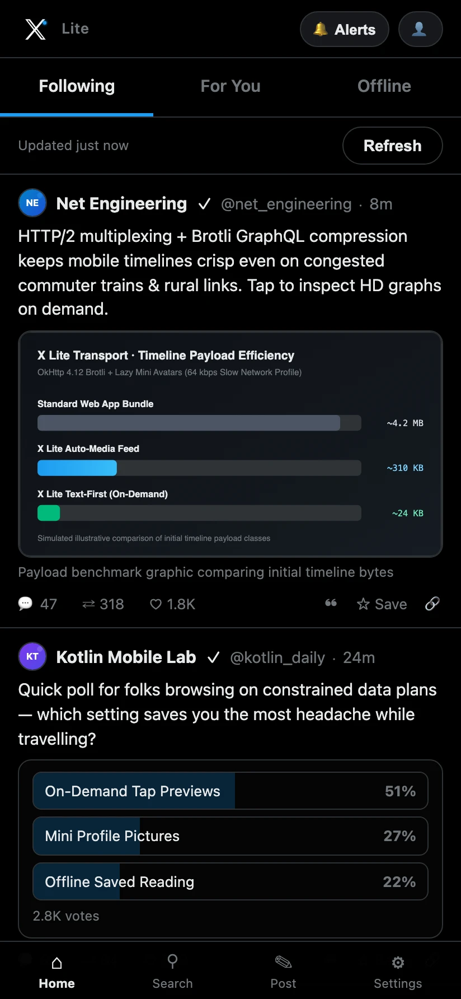
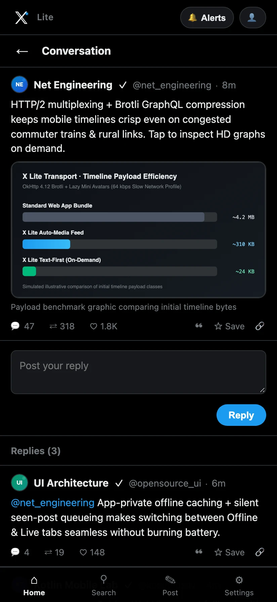
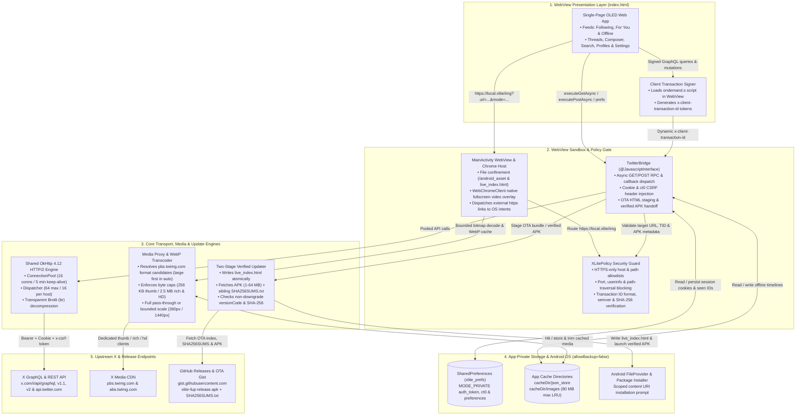

<p align="center">
  
</p>

<h1 align="center">X Lite</h1>

<p align="center">
  <b>A fast, data-saving Android client for X — built for slow connections, zero trackers, and instant reading.</b>
</p>

<p align="center">
  <a href="https://github.com/sovopr/xlite-android/actions/workflows/ci.yml"></a>
  <a href="https://github.com/sovopr/xlite-android/actions/workflows/dependency-submission.yml"></a>
  <a href="https://github.com/sovopr/xlite-android/actions/workflows/codeql.yml"></a>
  <a href="https://github.com/sovopr/xlite-android/releases/latest"></a>
  <a href="https://github.com/sovopr/xlite-android/releases"></a>
  <a href="LICENSE"></a>
</p>

---

## Screenshots

| Home Feed | Conversation Thread |
| :---: | :---: |
|  |  |

---

## Downloads (v1.0.33)

X Lite ships as a standalone signed Android APK with zero external analytics SDKs or background ad trackers.

| Platform | Package | Size | Description |
| :--- | :--- | :--- | :--- |
| **Android 7.0+ (API 24+)** | [**`xlite-fup-release.apk`**](https://github.com/sovopr/xlite-android/releases/latest/download/xlite-fup-release.apk) | ~5 MB | Signed standalone release APK bundling the OLED web client, native HTTP/2 bridge, media proxy cache, fullscreen video chrome, and in-app updater. |

Every GitHub release publishes [`SHA256SUMS.txt`](https://github.com/sovopr/xlite-android/releases/latest/download/SHA256SUMS.txt) alongside the APK so both you and the in-app updater verify integrity before installation.

---

## Step-by-Step Setup Guide

### Step 1: Install X Lite on Android
1. Download [**`xlite-fup-release.apk`**](https://github.com/sovopr/xlite-android/releases/latest/download/xlite-fup-release.apk) on your Android device (Android 7.0 or newer).
2. Open the downloaded `.apk` file and tap **Install**. If Android prompts you, enable **Allow from this source** for your browser or file manager.

### Step 2: Get Your `auth_token` and `ct0` Cookies from X

> [!IMPORTANT]
> **Keep these two values private.** Anyone with your `auth_token` and `ct0` cookies can access your X account. X Lite stores them only inside private on-device storage (`allowBackup="false"`) and sends them only to official X hosts.

Instead of asking for your X password, X Lite uses the session cookies from a browser where you are already logged in:

1. On a **computer**, open a browser and log in to **[x.com](https://x.com)**.
2. Open Developer Tools on that `x.com` tab and inspect its cookies:
   - **Chrome / Edge / Brave:** Press `F12` (or `Ctrl+Shift+I` on Windows/Linux, `Cmd+Option+I` on Mac) → open the **Application** tab → expand **Cookies** on the left → click **`https://x.com`**.
   - **Firefox:** Press `F12` (or `Ctrl+Shift+I` / `Cmd+Option+I`) → open the **Storage** tab → expand **Cookies** → click **`https://x.com`**.
   - **Safari (Mac):** Turn on developer tools once in **Safari → Settings → Advanced → Show features for web developers**. Then on your logged-in `x.com` tab, press `Cmd+Option+I` → open **Storage** → expand **Cookies** → click **`https://x.com`** *(if the list looks empty, refresh the `x.com` page once while Storage is open)*.
3. Locate these two cookie rows and copy their **Value** strings:
   - **`auth_token`**
   - **`ct0`**
4. Send both strings privately to your phone (for example via your password manager or encrypted notes).

### Step 3: Sign In & Pick Your Data Mode
1. Open **X Lite** and tap **Settings** in the bottom bar.
2. Under **Account Credentials**, paste your **`auth_token`** and **`ct0 (csrf token)`**.
3. Choose how X Lite loads media and timelines:
   - **Image Mode:**
     - **Tap to load small previews** — loads posts fast as text and lets you tap individual previews to view images (recommended for slow data).
     - **Auto-load previews** — loads full-resolution photos, HD MP4 video with fullscreen support, looping GIFs, and quoted-post media automatically while scrolling.
     - **Text only (0 KB)** — disables post images and video completely.
   - **Profile Pictures:** **Mini** (24px), **Standard** (48px), or **Initials only (0 KB)**.
   - **Promoted Posts (Ads):** Hide ads from feeds or keep them labeled with an **Ad** badge.
   - **Sync Seen Posts to X:** Optionally report scrolled posts back to X so the same posts repeat less often on desktop web.
4. Tap **Save Configuration**. Your **Following** and **For You** feeds will load right away.

### Step 4: Updating the App Later
- Open **Settings → App Updates → Check & Install Updates**.
- Lightweight UI fixes apply inside the app in seconds. When a new Android build is released, X Lite downloads the APK, verifies its SHA-256 checksum against `SHA256SUMS.txt`, and launches Android's installer automatically.
- You can tap **Revert to Bundled Version** at any time to roll back an over-the-air web update.

---

## Features

- **Following, For You & Offline Feeds:** Switch between chronological, algorithmic, and cached offline timelines, and clear local caches anytime with **Clear Cached Tweets**.
- **Complete Day-to-Day Actions:** Read conversation threads, reply, post, quote, like, repost, bookmark offline, search posts, browse user profiles, follow/unfollow accounts, and check notifications.
- **Built for Weak & Metered Networks:** Compresses API traffic with Brotli over HTTP/2, avoids loading desktop React bundles, and caches images locally as WebP.
- **Private by Design:** Zero analytics or third-party trackers; Android cloud backup is explicitly disabled (`android:allowBackup="false"`).

---

## Architecture

```
xlite-android/
├── android/                                  # Self-contained Gradle & Kotlin Android project
│   ├── app/
│   │   ├── build.gradle.kts                  # Android SDK 24-34 config, GIT_SHA BuildConfig & JUnit4
│   │   ├── proguard-rules.pro                # Release R8/ProGuard rules
│   │   └── src/
│   │       ├── main/
│   │       │   ├── AndroidManifest.xml       # allowBackup=false, FileProvider & package install perm
│   │       │   ├── assets/
│   │       │   │   └── index.html            # Self-contained OLED SPA, GraphQL/REST parsers & OTA UI
│   │       │   ├── java/com/sovopr/xlite/
│   │       │   │   ├── MainActivity.kt       # WebView host, local.xlite/img proxy & WebP disk cache
│   │       │   │   ├── TwitterBridge.kt      # @JavascriptInterface OkHttp Brotli bridge & APK updater
│   │       │   │   └── XLitePolicy.kt        # Pure-JVM URL allowlists, semver, SHA-256 & media policy
│   │       │   └── res/                      # Vector launcher icons, dark themes & FileProvider paths
│   │       └── test/
│   │           └── java/com/sovopr/xlite/
│   │               └── XLiteUnitTest.kt      # JUnit4 tests for allowlists, semver, SHA256SUMS & images
│   ├── gradle/                               # Gradle wrapper JAR and version properties
│   ├── build.gradle.kts                      # Root Android Gradle plugin config
│   ├── gradle.properties
│   ├── gradlew
│   └── settings.gradle.kts
├── scripts/
│   ├── verify-assets.cjs                     # Static validator: JS syntax, version parity, XML/SVG & leak scan
│   ├── feed-media.test.cjs                   # Feed navigation, refresh & media retry tests
│   ├── search-pagination.test.cjs            # Modern GET & legacy POST search pagination tests
│   ├── post-actions.test.cjs                 # Mutations, profile/notification & verified updater tests
│   └── live-search-smoke.cjs                 # Optional authenticated live search diagnostic script
├── docs/
│   ├── logo.svg                              # Vector application emblem
│   ├── social-preview.svg / .png             # Repository social card (1280x640)
│   ├── dependency-security.md                # Pinned Maven artifacts, zero-npm audit & SBOM pipeline
│   ├── releases/v1.0.33.md                   # Release notes for v1.0.33
│   └── screenshots/                          # Real Android device WebP screenshots (feed, thread)
└── .github/
    ├── CODE_OF_CONDUCT.md
    ├── CONTRIBUTING.md
    ├── SECURITY.md
    ├── dependabot.yml                        # Weekly Gradle & GitHub Actions update checks
    ├── pull_request_template.md
    ├── ISSUE_TEMPLATE/
    └── workflows/
        ├── ci.yml                            # Static verification, SPA suites, JUnit4, lint & APK build
        ├── dependency-submission.yml         # Resolved Gradle dependency graph submission to GitHub SBOM
        ├── codeql.yml                        # CodeQL SAST scanning (java-kotlin & javascript-typescript)
        └── build-apk.yml                     # Signed release workflow publishing APK + SHA256SUMS.txt
```

---

## Getting Started from Source

### Prerequisites
- **JDK 17** (`java -version`)
- **Android SDK** (`compileSdk = 34`, `minSdk = 24`, Android Build Tools)
- **Node.js 22+** (`node -v`) — uses the Node standard library only; no `npm install` required

### Build & Verify

```bash
git clone https://github.com/sovopr/xlite-android.git
cd xlite-android

# Static asset verification, version parity & headless SPA unit suites
node scripts/verify-assets.cjs
node scripts/feed-media.test.cjs
node scripts/search-pagination.test.cjs
node scripts/post-actions.test.cjs

# Kotlin unit tests, Android lint & release APK build
cd android
chmod +x gradlew
./gradlew testReleaseUnitTest lintRelease assembleRelease
```

Release builds are output to `android/app/build/outputs/apk/release/`. Signing credentials follow `XLITE_KEYSTORE_FILE`, `XLITE_KEYSTORE_PASSWORD`, `XLITE_KEY_ALIAS`, and `XLITE_KEY_PASSWORD` as configured in [build-apk.yml](.github/workflows/build-apk.yml).

---

## System Architecture

The diagram below traces every boundary between the sandboxed WebView UI, the native Kotlin policy gate, pooled network transport, app-private storage, and upstream X / GitHub services:



### Subsystem Architecture

#### 1. Pooled Brotli Transport & Transaction Signing
- **Shared HTTP/2 Client ([`TwitterBridge.kt`](android/app/src/main/java/com/sovopr/xlite/TwitterBridge.kt))**: Routes API calls, media fetches, and updates from one `ConnectionPool` (`16` idle connections, `5` minute keep-alive) with a `64`-request `Dispatcher` (`16` max per host) and `BrotliInterceptor` for compressed GraphQL payloads.
- **Query Fallbacks & Signing ([`index.html`](android/app/src/main/assets/index.html))**: Primary and fallback GraphQL query IDs absorb routine upstream rotations, while `XLitePolicy.isValidTransactionId` validates client-signed `x-client-transaction-id` tokens before dispatching search calls.

#### 2. Bandwidth-Aware WebP Media Pipeline & Fullscreen Video
- **Localhost Proxy Interception ([`MainActivity.kt`](android/app/src/main/java/com/sovopr/xlite/MainActivity.kt))**: `WebViewClient.shouldInterceptRequest` intercepts `https://local.xlite/img` requests exclusively for `pbs.twimg.com`, enforcing mode-based download limits (`256 KB` thumb, `2560 KB` rich & HD) and `large`-first `XLitePolicy.buildImageCandidateUrls` resolution in `Auto-load previews`.
- **Full-Resolution Pass-Through & Fullscreen Chrome**: Well-sized `rich` and `hd` photos stream through without wasted CPU re-encoding and trim asynchronously under an `80 MB` ceiling in `cacheDir/images/`, while `WebChromeClient` handles native edge-to-edge fullscreen `<video>` playback.

#### 3. Strict Allowlisting & App-Private Storage Isolation
- **Defense-in-Depth URL Validation ([`XLitePolicy.kt`](android/app/src/main/java/com/sovopr/xlite/XLitePolicy.kt))**: Non-HTTPS URLs, custom ports, embedded credentials (`userinfo@`), `..` traversal segments, non-allowlisted GraphQL endpoints, and unapproved release origins are rejected before opening a socket.
- **Device-Only Data ([`AndroidManifest.xml`](android/app/src/main/AndroidManifest.xml))**: `android:allowBackup="false"` keeps `xlite_prefs` (`MODE_PRIVATE`), offline feeds (`cacheDir/json_store`), and cached media scoped strictly to the app sandbox.

#### 4. Two-Stage Verified OTA & Native APK Updater
- **Atomic Live Interface Updates**: Smaller HTML/JS parser fixes write atomically to `filesDir/live_index.html`, with immediate rollback via **Revert to Bundled Version**.
- **SHA-256 Verified APK Upgrades**: Native upgrades download both `xlite-fup-release.apk` (`1 MB–64 MB` bounds) and its sibling `SHA256SUMS.txt` on GitHub Releases, verify non-downgrade `versionCode` + semantic version + SHA-256 digest via `MessageDigest`, and install via scoped `FileProvider` URIs.

---

## Technical Specifications

| Component | Implementation |
| :--- | :--- |
| Language & Target | Kotlin (JVM 17), Android SDK 24–34 (`minSdk = 24`, `targetSdk = 34`), Android WebView |
| Client UI Surface | Self-contained ~210 KB OLED dark single-page web application (`index.html`), zero npm/runtime frameworks |
| Networking & Compression | OkHttp `4.12.0` + `okhttp-brotli:4.12.0`, HTTP/2 `ConnectionPool(16, 5m)`, `Dispatcher(64 max / 16 per host)` |
| Media Proxy & Caching | `local.xlite/img` interceptor, `pbs.twimg.com` candidate fallback, WebP transcoding, `80 MB` cache cap (`cacheDir/images`) |
| Security & Policy Gate | Pure-JVM `XLitePolicy` HTTPS/host/path/transaction guard, `allowBackup="false"`, `MODE_PRIVATE` prefs, `FileProvider` |
| Updater Pipeline | Atomic `filesDir/live_index.html` OTA web bundle + SHA-256 (`SHA256SUMS.txt`) & `versionCode` verified APK installer |
| Testing & Static Analysis | JUnit4 (`XLiteUnitTest.kt`), Android Lint (`lintRelease`), Node standard-library test suites (`scripts/*.cjs`), CodeQL SAST |
| Supply Chain & Dependency Graph | Pinned Gradle coordinates, `.github/dependabot.yml` (`/android` & `/android/app`), Gradle Dependency Submission (`Insights → Dependency graph`) |

See also: [Contributing](.github/CONTRIBUTING.md) · [Security Policy](.github/SECURITY.md) · [Dependency Security](docs/dependency-security.md) · [Code of Conduct](.github/CODE_OF_CONDUCT.md) · [v1.0.33 Release Notes](docs/releases/v1.0.33.md)

---

## License

[MIT](LICENSE)
