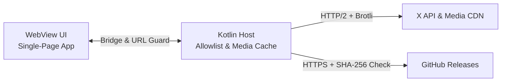

<p align="center">
  
</p>

<h1 align="center">X Lite</h1>

<p align="center">
  <b>A fast, data-saving Android client for X — built for slow connections, zero trackers, and instant reading.</b>
</p>

<p align="center">
  <a href="https://github.com/sovopr/xlite-android/actions/workflows/ci.yml"></a>
  <a href="https://github.com/sovopr/xlite-android/actions/workflows/codeql.yml"></a>
  <a href="https://github.com/sovopr/xlite-android/releases/latest"></a>
  <a href="https://github.com/sovopr/xlite-android/releases"></a>
  <a href="LICENSE"></a>
</p>

---

## Screenshots

| Home Feed | Conversation Thread |
| :---: | :---: |
|  |  |

---

## Downloads (v1.0.24)

| Platform | Package | Size | Notes |
| :--- | :--- | :--- | :--- |
| **Android 7.0+ (API 24+)** | [**`xlite-fup-release.apk`**](https://github.com/sovopr/xlite-android/releases/latest/download/xlite-fup-release.apk) | ~5 MB | Signed standalone APK with verified in-app updates. |

Every release publishes [`SHA256SUMS.txt`](https://github.com/sovopr/xlite-android/releases/latest/download/SHA256SUMS.txt) alongside the APK so both you and the in-app updater verify integrity before installing.

---

## Step-by-Step Setup Guide

### Step 1: Install X Lite on Android
1. Download [**`xlite-fup-release.apk`**](https://github.com/sovopr/xlite-android/releases/latest/download/xlite-fup-release.apk) on your Android phone (Android 7.0 or newer).
2. Tap the downloaded APK file to install it. If Android asks, turn on **Allow from this source** for your browser or file manager.

### Step 2: Get Your `auth_token` and `ct0` Cookies from X

> [!IMPORTANT]
> **Keep these two values private.** Anyone with your `auth_token` and `ct0` cookies can access your X account. X Lite stores them only inside private on-device storage (`allowBackup="false"`) and sends them only to official X hosts.

Instead of asking for your X password, X Lite uses the session cookies from a browser where you are already logged in:

1. On a **computer**, open a browser and log in to **[x.com](https://x.com)**.
2. Open Developer Tools on that `x.com` tab and inspect its cookies:
   - **Chrome / Edge / Brave:** Press `F12` (or `Ctrl+Shift+I` on Windows/Linux, `Cmd+Option+I` on Mac) → open the **Application** tab → expand **Cookies** on the left → click **`https://x.com`**.
   - **Firefox:** Press `F12` (or `Ctrl+Shift+I` / `Cmd+Option+I`) → open the **Storage** tab → expand **Cookies** → click **`https://x.com`**.
   - **Safari (Mac):** Turn on developer tools once in **Safari → Settings → Advanced → Show features for web developers**. Then on your logged-in `x.com` tab, press `Cmd+Option+I` → open **Storage** → expand **Cookies** → click **`https://x.com`** *(if the list looks empty, refresh the `x.com` page once while Storage is open)*.
3. Locate these two cookie rows and copy their **Value** strings:
   - **`auth_token`**
   - **`ct0`**
4. Send both strings privately to your phone (for example via your password manager or encrypted notes).

### Step 3: Sign In & Pick Your Data Mode
1. Open **X Lite** and tap **Settings** in the bottom bar.
2. Under **Account Credentials**, paste your **`auth_token`** and **`ct0 (csrf token)`**.
3. Choose how X Lite loads media and timelines:
   - **Image Mode:**
     - **Tap to load small previews** — loads posts fast as text and lets you tap individual previews to view images (best for slow connections).
     - **Auto-load previews** — loads photos and auto-pausing inline video while scrolling.
     - **Text only (0 KB)** — disables post images and video completely.
   - **Profile Pictures:** **Mini**, **Standard**, or **Initials only (0 KB)**.
   - **Promoted Posts (Ads):** Hide promoted posts or show them with an **Ad** badge.
   - **Sync Seen Posts to X:** Optionally report scrolled posts back to X so the same posts repeat less often on desktop web.
4. Tap **Save Configuration**. Your feed loads right away.

### Step 4: Updating the App Later
- Open **Settings → App Updates → Check & Install Updates**.
- Lightweight UI fixes apply inside the app in seconds. When a new Android build is released, X Lite downloads the APK, verifies its SHA-256 checksum against `SHA256SUMS.txt`, and opens Android's installer automatically.
- You can tap **Revert to Bundled Version** at any time to roll back an over-the-air UI update.

---

## Features

- **Following, For You & Offline Feeds:** Switch timelines cleanly and save posts locally for offline reading.
- **Full Core Actions:** View threads, post, reply, quote, like, repost, bookmark offline, search posts, browse user profiles, and check notifications.
- **Built for Weak & Metered Networks:** Compresses API traffic, avoids multi-megabyte web app bundles, and caches images locally as WebP.
- **Private by Design:** Zero analytics or third-party trackers; cloud backup disabled (`android:allowBackup="false"`).

---

## Technical Overview (Crisp)

- **App Shell:** Native Kotlin host (`Android SDK 24–34`) running a self-contained ~210 KB OLED WebView interface ([`index.html`](app/src/main/assets/index.html)) with zero external JS libraries.
- **Network & Media Cache:** Shared `OkHttp 4.12` + `Brotli` HTTP/2 transport ([`TwitterBridge.kt`](app/src/main/java/com/sovopr/xlite/TwitterBridge.kt)) alongside a local WebP image proxy & disk cache ([`MainActivity.kt`](app/src/main/java/com/sovopr/xlite/MainActivity.kt)).
- **Security Checks:** Pure-JVM host/path allowlists, URL traversal/port blocking, non-downgrade version checks, and SHA-256 release verification ([`XLitePolicy.kt`](app/src/main/java/com/sovopr/xlite/XLitePolicy.kt)); private device-only preferences ([`AndroidManifest.xml`](app/src/main/AndroidManifest.xml)).



---

## Build & Verify from Source

**Requirements:** JDK 17, Android SDK (`compileSdk = 34`, `minSdk = 24`), and Node.js 22+ (zero `npm install` packages needed).

```bash
git clone https://github.com/sovopr/xlite-android.git
cd xlite-android

# Static checks & headless SPA unit suites
node scripts/verify-assets.cjs
node scripts/feed-media.test.cjs
node scripts/search-pagination.test.cjs
node scripts/post-actions.test.cjs

# Kotlin unit tests, Android lint & release APK
chmod +x gradlew
./gradlew testReleaseUnitTest lintRelease assembleRelease
```

See also: [Contributing](CONTRIBUTING.md) · [Security Policy](SECURITY.md) · [Dependency Security](docs/dependency-security.md) · [Code of Conduct](CODE_OF_CONDUCT.md) · [v1.0.24 Release Notes](docs/releases/v1.0.24.md)

---

## License

[MIT](LICENSE)
